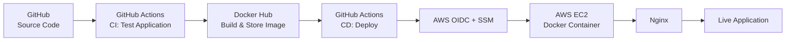

# enterprise-deployment-platform
An automated application deployment platform that automates the process of testing, packaging, and releasing an application to a live environment. Provides end-to-end DevOps deployment workflow with secure cloud authentication, automated deployments, rollback and infrastructure automation. Built using Python, Docker, GitHub Actions and AWS.

## Architecture

## Technology Stack

| Technology | Purpose |
|---|---|
| Python (Flask) | Application development |
| Pytest | Application testing |
| Git & GitHub | Version control |
| GitHub Actions | CI/CD automation |
| Docker | Application containerization |
| Docker Hub | Docker image storage |
| AWS EC2 | Application hosting |
| AWS Systems Manager (SSM) | Remote deployment execution |
| AWS IAM & OIDC | Secure AWS authentication |
| Nginx | Reverse proxy |
| Gunicorn | Python application server |

## Deployment Workflow

1. Code changes are pushed to the GitHub repository.
2. GitHub Actions runs application validation and tests.
3. On successful CI, a Docker image is built and pushed to Docker Hub.
4. GitHub Actions authenticates with AWS using OIDC.
5. AWS Systems Manager sends deployment commands to EC2.
6. EC2 pulls the Docker image and starts the application container.
7. Nginx forwards incoming requests to the application.

## Future Enhancements

- **Automated Rollback:** Restore the previous working version if a deployment fails.
- **Infrastructure as Code (Terraform):** Automate AWS infrastructure provisioning.
- **Monitoring and Logging:** Improve application health monitoring and deployment visibility.

## Project Status

CI/CD pipeline and Docker-based deployment are implemented and working. Automated rollback and Terraform-based infrastructure provisioning are planned.

