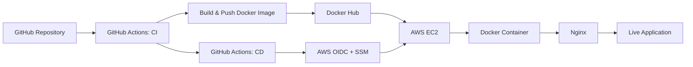

# enterprise-deployment-platform
An automated application deployment platform built using Python, Docker, GitHub Actions and AWS. The project implements a CI/CD pipeline that tests application code, builds and publishes Docker images, and deploys the application to an AWS EC2 instance through AWS Systems Manager (SSM).

The goal is to build a practical, end-to-end DevOps deployment workflow with secure cloud authentication, automated deployments, rollback and infrastructure automation.

## Architecture

